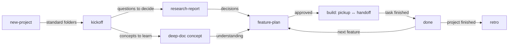

# claude-code-project-kit

[](https://github.com/Bharat-RanaHimanshu/claude-code-project-kit/actions/workflows/test.yml)


[](LICENSE)

**Claude Code skills that run every project the same way, from the first question to the final story.** Nothing is lost between sessions, every decision keeps its reason, and when the project ends you understand *why* it was built the way it was, not just *that* it works.

- **No more lost context.** Work is resumed from files (`/pickup`, `/handoff`), not from memory, so a new session or a full context window costs nothing.
- **Reasons, not just results.** Decisions, research, plans and lessons are written down as the project happens, each with an ID you can follow.
- **Nothing old breaks silently.** Every project gets a test strategy (unit, integration, contract, end-to-end), plans list their tests up front, bugs get a regression test first, and the full suite runs before any task counts as done.
- **Learn while you build.** A learning mode makes Claude explain the why, introduce concepts before using them, and check your understanding.
- **Cheap by default.** Everything is Markdown. HTML pages are generated only when you ask, mostly by a script rather than by Claude.

## The lifecycle



## The skills

| Phase | Skill | What it does |
|---|---|---|
| Set up | **`/new-project`** | Creates the standard folders from a template with a bash script, so every project is identical. Never overwrites a file; can also compare an old project with the current template. |
| Start | **`/kickoff`** | Writes `docs/charter.md` (problem, goals, success criteria, scope, non-goals) and turns the unknowns into research and learning tasks. |
| Decide | **`/research-report`** | Researches a "which option?" question with sources and writes `research/YYYY-MM-DD-topic.md`: answer first, options compared, recommendation. Logs the decisions. |
| Learn and explain | **`/deep-doc`** | Detailed docs for features, flows, architecture and **concepts**, with a fixed outline: mental model, diagram first, trade-offs linked to decisions, worked example, where it is in the code. |
| Plan | **`/feature-plan`** | One plan per feature (goal, steps, files, risks, and the tests per layer), approved by you before any code changes. |
| Build | **`/pickup`** | Starts a session: reads the handoff and tracker, compares them with git, reports where things stand in ten lines. |
| Build | **`/handoff`** | Ends a session: logs decisions and lessons, updates the tracker, rewrites `session/HANDOFF.md` for a reader with no memory. |
| Finish a task | **`/done`** | Runs the definition of done for real: the full test suite, docs, decisions, lessons, the plan's Outcome, checks, commit. |
| Report | **`/status-brief`** | A one-page, plain-language brief for your team head: status, risks, decisions needed, next steps with dates. |
| Close | **`/retro`** | Brings every doc up to date and writes `docs/story.md`: timeline, key decisions and why, lessons, test-yourself questions, and a reading guide. |

Claude also picks the right skill on its own when your request fits ("plan the login feature", "where were we?", "write this up for my manager").

## What a project looks like

```text
my-app/
├── CLAUDE.md            rules Claude follows here (purpose, workflow, definition of done)
├── README.md            for people
├── inputs/              documents the team gave you (read-only, listed in a table)
├── research/            one report per question, with a summary table
├── code/
│   ├── backend/         its own CLAUDE.md: stack, commands, conventions
│   └── frontend/
├── docs/
│   ├── charter.md       why the project exists
│   ├── architecture.md  api.md  runbook.md  glossary.md
│   ├── testing.md       test layers, rules, commands, and what proves each requirement
│   ├── decisions.md     D-001…  append-only, with alternatives and reasons
│   ├── learnings.md     L-001…  bugs, dead ends, surprises, and the lesson
│   ├── tracker.md       T-001…  Now / Next / Blocked / Done
│   ├── story.md         written at the end: the narrative and reading guide
│   ├── features/  flows/  concepts/  briefs/
│   └── visual/          generated HTML, only when asked
└── session/
    ├── HANDOFF.md       working state for the next session
    └── plans/           one plan per feature; finished ones in done/
```

Every folder has a short README saying what goes in, what doesn't, how files are named and when they're updated.

## Install

You need [Claude Code](https://code.claude.com), git, and bash (on Windows, the Git Bash that comes with [Git for Windows](https://git-scm.com/download/win)).

```bash
git clone https://github.com/Bharat-RanaHimanshu/claude-code-project-kit.git
cd claude-code-project-kit
bash install.sh
```

This copies the skills into `~/.claude/skills`, so they work in every project on that machine. Restart Claude Code afterwards.

**Update:** `git pull && bash install.sh`. Skills that changed are replaced and the old copies are kept in `~/.claude/kit-backups/`.

**Claude Code on the web:** cloud sessions don't see the skills on your computer. Either add the skill folders to your claude.ai account's skills (upload all of them: they use each other's scripts), or copy `skills/` into a project repository's `.claude/skills/` folder.

## Your first project

```text
/new-project my-app          answer the questions in one message
/kickoff                     the charter, and the list of unknowns
/research-report …           for each "which option?" question
/deep-doc concept …          for each idea you need to understand
/feature-plan login          approve the plan, then build
/handoff   …   /pickup       end and start of every session
/done                        when a task is finished
/retro                       when the project is finished
```

## Learning or production

`/new-project` asks which kind of project it is, and writes a different working style into its `CLAUDE.md`.

| | Learning | Production |
|---|---|---|
| Explanations | The why before each step; concepts introduced before they're used | Short |
| When you could try it yourself | A hint first, the solution if you ask | Claude does it |
| End of each plan | You explain the key idea back, or predict a change | Tests and a security review where it matters |
| Tests | Claude says what each test proves; you're offered one to write yourself per plan | Full suite in CI on every push; a red build blocks merging |
| Lessons | Every bug and dead end, with the general rule | Notable bugs and incidents |

Both keep the same decision log, lessons log and final story.

## How it's designed

- **Markdown first.** Every doc is Markdown and readable on GitHub, Mermaid diagrams included. HTML is generated only on request.
- **Files over memory.** Claude resumes from the handoff, the tracker and git, never from what it remembers.
- **Never overwrite.** The setup script only adds missing files; running it twice changes nothing.
- **IDs from a script.** Decision, task and lesson numbers come from `next-id.sh`, so they're never miscounted or reused.
- **Conventions are checked, not hoped for.** `check-project.sh` reports missing index rows, broken links, numbering gaps, outdated pages and unfinished plans.
- **Tested in layers.** Unit tests for logic, integration tests where parts meet, contract tests against `docs/api.md`, and a few end-to-end tests for key journeys. A coverage map in `docs/testing.md` shows which tests prove each requirement.
- **Lessons survive.** The handoff is rewritten every session; anything learned goes into the append-only `docs/learnings.md` first.

### HTML, only when you ask

| | Quick page | Rich page |
|---|---|---|
| Made by | a script (`md-to-html.sh`), almost no tokens | Claude, only when you ask |
| Contains | the Markdown with a contents sidebar, light and dark mode, Mermaid diagrams, charts from ```` ```chart ```` blocks, callouts from `> [!NOTE]` | everything, plus tabs, step-throughs and number tiles |

`md-to-html.sh --all` turns a finished project into a browsable site starting at `docs/visual/index.html`. Libraries load from jsDelivr pinned to exact versions with integrity hashes. Offline, pages fall back to the raw text and data tables.

### Scripts

| Script | What it does |
|---|---|
| `new-project/scripts/new-project.sh` | Create or complete a project; `--scan` an existing folder; `--diff` against the template |
| `new-project/scripts/next-id.sh` | Next free `D-`, `T-` or `L-` number |
| `new-project/scripts/check-project.sh` | Check a project against the conventions |
| `handoff/scripts/repo-state.sh` | Branch, last commit and changes of every repository in the project |
| `deep-doc/scripts/md-to-html.sh` | Quick HTML pages from Markdown |
| `deep-doc/scripts/wrap-page.sh` | Wrap a rich page body in the shared page shell |

All scripts are bash 3.2 compatible with LF line endings, and run in Git Bash on Windows, macOS and Linux.

## Tests

Every push runs the tests on **Linux**, **macOS with bash 3.2** and **Windows with Git Bash**, plus a **Chromium** test that opens the generated pages in light, dark and phone layouts against the live CDN. Locally:

```bash
bash tests/run-tests.sh
```

## Add your own skill

1. Create `skills/<name>/SKILL.md` with `name` and a `description` that says what it does **and when to use it**. Claude uses the description to decide when the skill applies.
2. Put scripts in `skills/<name>/scripts/` and refer to them as `<skill-dir>/scripts/…`.
3. Follow the rules in [`CLAUDE.md`](CLAUDE.md) (bash 3.2, LF, never overwrite).
4. Add it to the table above, bump `skills/new-project/VERSION`, add a [`CHANGELOG.md`](CHANGELOG.md) entry, run the tests, then `bash install.sh`.

## License

[MIT](LICENSE)
