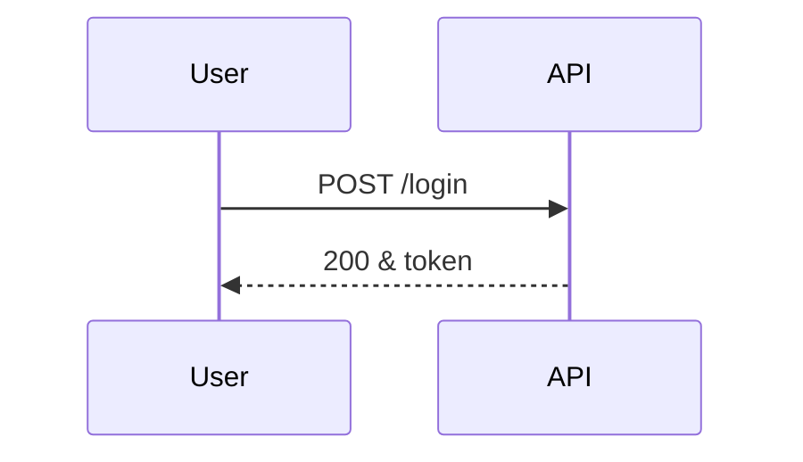

# Demo feature

> **Status:** draft · **Updated:** 2026-10-18

## In short

A test doc for quick pages: Unicode (café, 日本語), links, callouts, a diagram and a chart.

> [!TIP]
> Tips become callouts.

> [!WARNING]
> So do warnings.

## How it works



See [the API contract](../api.md#endpoints) and [the inputs list](../../inputs/README.md).

## Numbers

```chart
{"type": "bar", "title": "Requests per day", "labels": ["Mon", "Tue", "Wed"], "series": [{"name": "Requests", "data": [120, 340, 90]}]}
```

| Step | Time |
|---|---|
| Parse | 2 ms |
| Query | 14 ms |

## Code

```html
<script>alert("this must stay text")</script>
```

- [x] Done item
- [ ] Open item
